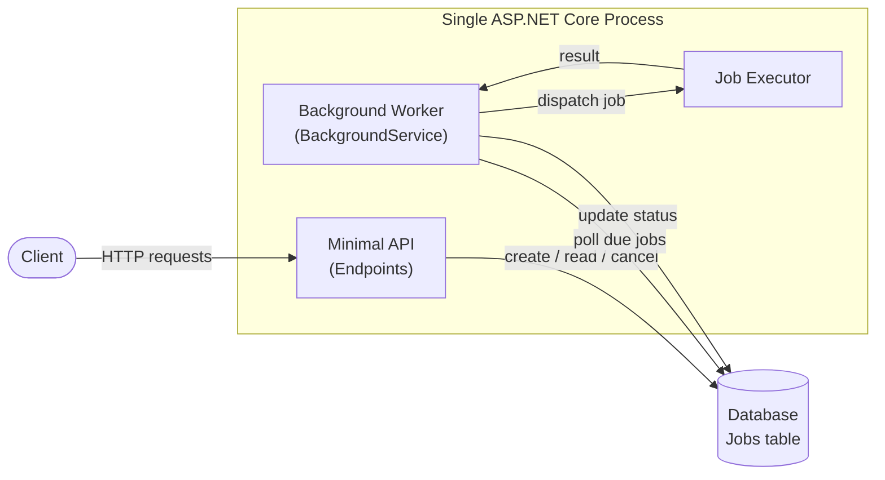
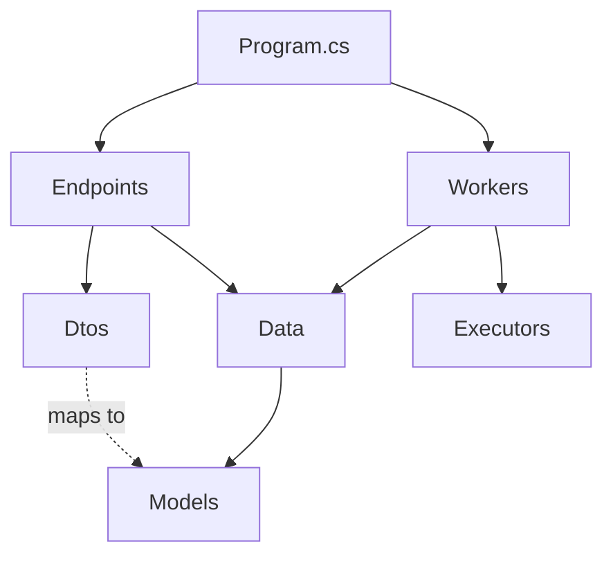
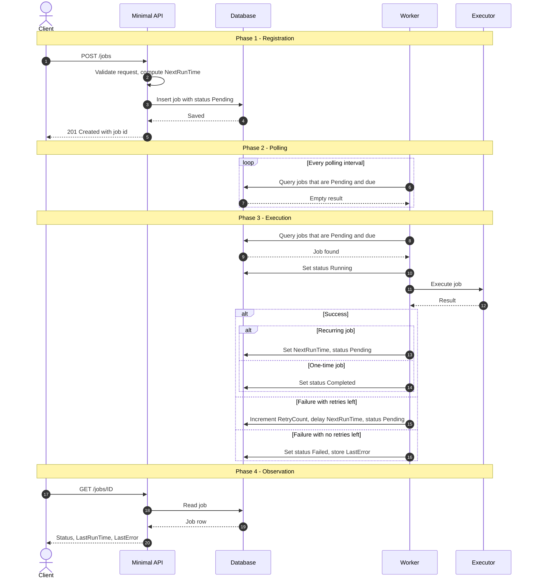
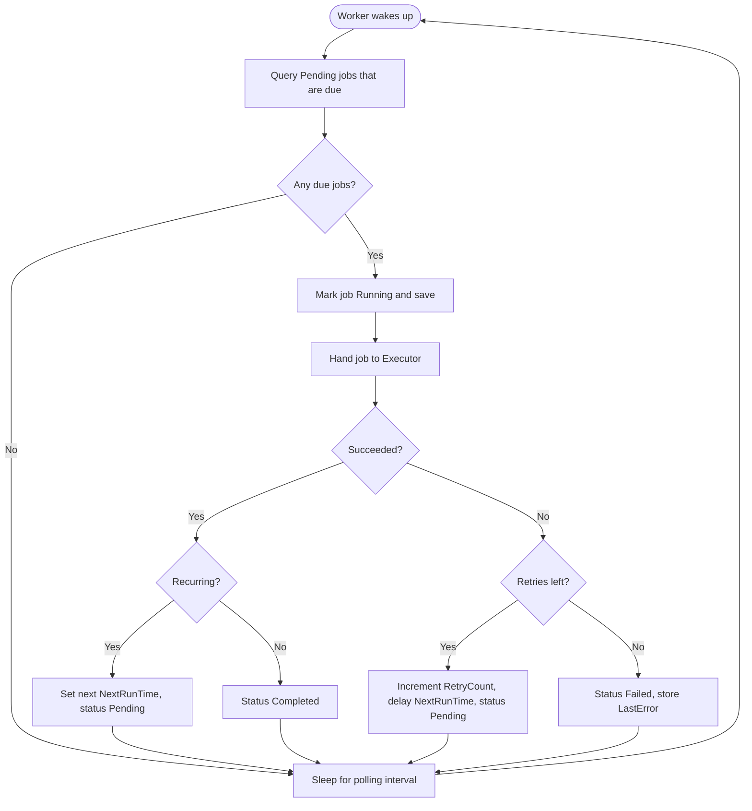
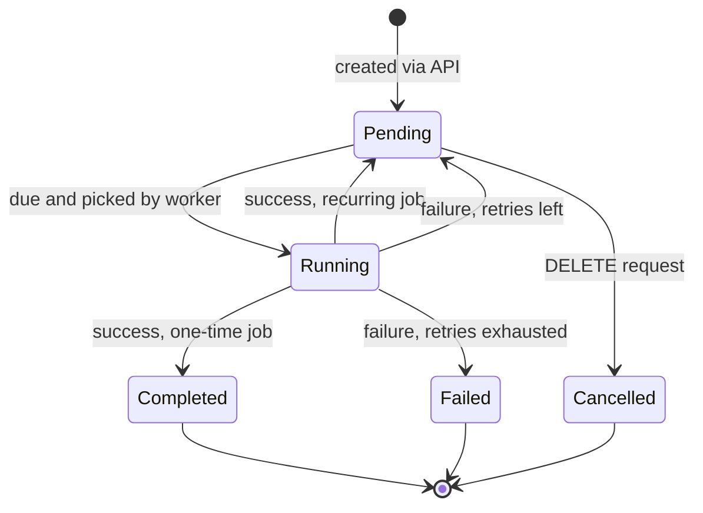
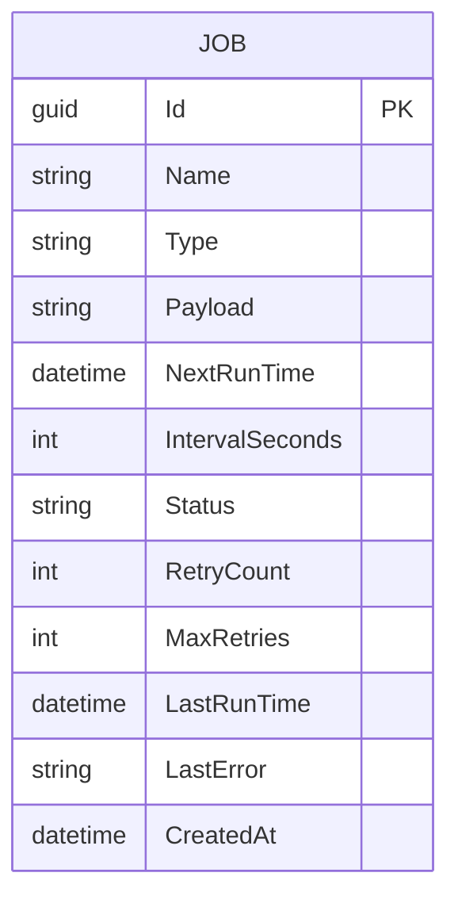
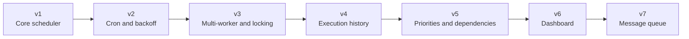

# Job Scheduler

A lightweight, self-hosted job scheduling service built with **ASP.NET Core Minimal APIs**. Register a job through a REST endpoint, and a background worker runs it when it is due, tracks the result, retries on failure, and reschedules it if it recurs.


---

## Table of Contents

1. [Overview](#overview)
2. [Design Principles](#design-principles)
3. [System Architecture](#system-architecture)
4. [Project Hierarchy](#project-hierarchy)
5. [Dependency Rules](#dependency-rules)
6. [The Job Lifecycle](#the-job-lifecycle)
7. [Worker Loop](#worker-loop)
8. [Job State Machine](#job-state-machine)
9. [Data Model](#data-model)
10. [API Reference](#api-reference)
11. [Configuration](#configuration)
12. [Getting Started](#getting-started)
13. [Design Decisions](#design-decisions)
14. [Known Limitations](#known-limitations)
15. [Roadmap](#roadmap)
16. [Glossary](#glossary)

---

## Overview

The scheduler does exactly three things:

| Responsibility | Description |
|---|---|
| **Store** | Persist every job: what to run, when to run it, and what happened last time. |
| **Watch** | Continuously check the clock and find jobs whose time has come. |
| **Execute** | Run the job, record the outcome, and decide what happens next. |

Version 1 is intentionally small. It is designed so that each later capability (cron expressions, multiple workers, dashboards) can be added without rewriting what already exists.

---

## Design Principles

- **Simple first, powerful later.** Every v1 decision favors the smallest thing that works. Complexity is added only when a real need appears.
- **The database is the source of truth.** The worker holds no important state in memory. If the process restarts, nothing about the schedule is lost.
- **One process, one project.** The API and the worker live in the same application. There is no message broker, no separate service, and no multi-project solution in v1.
- **Extensible by addition.** New job types are new classes. New endpoints are new files. Existing code stays untouched.

---

## System Architecture

Everything runs inside a single ASP.NET Core process. The API and the worker never call each other directly. They communicate only through the database.



### Who does what

| Level | Component | Responsibility |
|---|---|---|
| 1 | **Client** | Requests job creation, inspection, and cancellation. |
| 2 | **Minimal API** | Validates input, calculates the first run time, saves the job. Never executes anything. |
| 3 | **Database** | Durable memory. Holds every job and its current state. |
| 4 | **Worker** | The clock. Wakes up periodically and asks: "what is due now?" |
| 5 | **Executor** | The hands. Performs the actual work for a given job type. |

---

## Project Hierarchy

One project, organized by responsibility.

```
Job-Scheduler/
└── JobScheduler/
    ├── Program.cs                    Application entry point and service registration
    ├── appsettings.json              Configuration (polling interval, retries, connection string)
    │
    ├── Models/
    │   ├── Job.cs                    The Job entity
    │   └── JobStatus.cs              Enum: Pending, Running, Completed, Failed, Cancelled
    │
    ├── Data/
    │   └── AppDbContext.cs           EF Core DbContext
    │
    ├── Dtos/
    │   ├── CreateJobRequest.cs       Shape of data the client sends
    │   └── JobResponse.cs            Shape of data the API returns
    │
    ├── Endpoints/
    │   └── JobEndpoints.cs           Route definitions (POST, GET, DELETE /jobs)
    │
    ├── Workers/
    │   └── JobWorker.cs              BackgroundService: the polling loop
    │
    └── Executors/
        └── HttpJobExecutor.cs        Runs jobs of type "http"
```

### Folder responsibilities

| Folder | Contains | Rule of thumb |
|---|---|---|
| `Models` | Entities that map to database tables | No logic about HTTP or scheduling |
| `Data` | The `DbContext` | The only place that talks to the database directly |
| `Dtos` | Request and response shapes | The entity is never exposed to clients |
| `Endpoints` | Minimal API route groups | Thin: validate, call data, return |
| `Workers` | Background services | Owns the polling loop and state transitions |
| `Executors` | One class per job type | Knows how to do work, not when to do it |

---

## Dependency Rules

Arrows show "is allowed to use". Anything not shown here is not allowed.



Key consequences:

- `Endpoints` and `Workers` never reference each other. They are independent users of the same data.
- `Executors` never touch the database. They receive a job, do work, and return a result.
- `Models` depends on nothing.

---

## The Job Lifecycle

A complete walkthrough using a concrete example:

> **Job:** "Ping my website". Call `https://example.com/health` every 24 hours, starting tomorrow at 09:00.



### Phase by phase

**Phase 1: Registration.** The client asks for a job to be created. The API validates the request, calculates `NextRunTime`, and stores the job as `Pending`. At this point nothing has been executed. The API's work is finished.

**Phase 2: Polling.** The worker wakes up every few seconds and asks the database for jobs that are `Pending` and whose `NextRunTime` has passed. Until the scheduled moment arrives, the answer is always empty and the worker goes back to sleep.

**Phase 3: Execution.** When a job becomes due, the worker first marks it `Running` and saves. This happens **before** execution so that the next polling cycle cannot pick up the same job again. The worker then hands the job to the matching executor and waits for the result. Depending on the result, the job is rescheduled, completed, retried, or failed.

**Phase 4: Observation.** At any time, the client can read the job to see its status, when it last ran, and the last error if there was one.

---

## Worker Loop

The decision logic the worker repeats forever.



---

## Job State Machine

Every job is always in exactly one state.



| State | Meaning | Terminal |
|---|---|---|
| `Pending` | Waiting for its `NextRunTime` | No |
| `Running` | Currently being executed by the worker | No |
| `Completed` | One-time job finished successfully | Yes |
| `Failed` | All retry attempts used up | Yes |
| `Cancelled` | Removed by the client before or between runs | Yes |

---

## Data Model

A single table is enough for v1.



| Field | Purpose |
|---|---|
| `Id` | Unique identifier |
| `Name` | Human-readable label |
| `Type` | Selects the executor (for example `http`) |
| `Payload` | JSON describing what to do (for example the URL and method) |
| `NextRunTime` | The moment the job becomes due. This is the field the worker queries on. |
| `IntervalSeconds` | Repeat interval. `null` means a one-time job. |
| `Status` | Current state, see the state machine above |
| `RetryCount` / `MaxRetries` | Current failed attempts and the allowed limit |
| `LastRunTime` | When the job last executed |
| `LastError` | Message from the most recent failure |
| `CreatedAt` | Audit timestamp |

---

## API Reference

| Method | Route | Description | Success |
|---|---|---|---|
| `POST` | `/jobs` | Create a job | `201 Created` |
| `GET` | `/jobs` | List jobs, optionally filtered by `?status=` | `200 OK` |
| `GET` | `/jobs/{id}` | Get a single job | `200 OK` |
| `DELETE` | `/jobs/{id}` | Cancel a job | `204 No Content` |

### Create a job

**Request**

```http
POST /jobs
Content-Type: application/json

{
  "name": "Ping my website",
  "type": "http",
  "payload": {
    "url": "https://example.com/health",
    "method": "GET"
  },
  "runAt": "2026-11-08T09:00:00Z",
  "intervalSeconds": 86400,
  "maxRetries": 2
}
```

**Response**

```http
201 Created
Location: /jobs/3f2b8c1e-7a4d-4e5b-9c1a-2d6f0b8e1a77

{
  "id": "3f2b8c1e-7a4d-4e5b-9c1a-2d6f0b8e1a77",
  "name": "Ping my website",
  "status": "Pending",
  "nextRunTime": "2026-11-08T09:00:00Z",
  "retryCount": 0,
  "lastRunTime": null,
  "lastError": null
}
```

### Error responses

| Status | When |
|---|---|
| `400 Bad Request` | Missing fields, unknown job type, invalid payload, or a run time in the past |
| `404 Not Found` | The job id does not exist |
| `409 Conflict` | Cancelling a job that is already in a terminal state |

---

## Configuration

```json
{
  "ConnectionStrings": {
    "Default": "Server=localhost;Database=JobScheduler;Trusted_Connection=True;TrustServerCertificate=True"
  },
  "Scheduler": {
    "PollingIntervalSeconds": 10,
    "DefaultMaxRetries": 2,
    "RetryDelaySeconds": 60,
    "HttpTimeoutSeconds": 30
  }
}
```

| Setting | Effect |
|---|---|
| `PollingIntervalSeconds` | How often the worker checks for due jobs. Lower means more precise timing and more database queries. |
| `DefaultMaxRetries` | Retry limit used when a job does not specify its own |
| `RetryDelaySeconds` | Wait time before a failed job becomes due again |
| `HttpTimeoutSeconds` | Maximum time the HTTP executor waits for a response |

If you use SQL Server LocalDB (installed with Visual Studio), use this connection string instead:

```json
"Default": "Server=(localdb)\\MSSQLLocalDB;Database=JobScheduler;Trusted_Connection=True"
```

---

## Getting Started

**Prerequisites:**

- The .NET SDK
- A running SQL Server instance (Express, LocalDB, or Docker). Unlike a file-based database, SQL Server must be running before the application starts.
- The EF Core command-line tool: `dotnet tool install --global dotnet-ef`

```bash
# Create the project
mkdir Job-Scheduler
cd Job-Scheduler
dotnet new web -n JobScheduler
cd JobScheduler

# Add dependencies
dotnet add package Microsoft.EntityFrameworkCore.SqlServer
dotnet add package Microsoft.EntityFrameworkCore.Design

# Create the database schema (after the Job model and AppDbContext exist)
dotnet ef migrations add InitialCreate
dotnet ef database update

# Run
dotnet run
```

Once the application is running, create a job:

```bash
curl -X POST http://localhost:5000/jobs \
  -H "Content-Type: application/json" \
  -d '{"name":"Ping my website","type":"http","payload":{"url":"https://example.com/health","method":"GET"},"runAt":"2026-11-08T09:00:00Z","intervalSeconds":86400,"maxRetries":2}'
```

---

## Design Decisions

| Decision | Reasoning |
|---|---|
| **Polling instead of timers or a queue** | Polling is trivial to reason about and survives restarts, because the schedule lives in the database rather than in memory. |
| **`BackgroundService` inside the API process** | One deployable unit. No inter-process communication to design or debug. |
| **Mark `Running` before executing** | Prevents the next polling cycle from picking up the same job twice. |
| **Interval-based recurrence in v1** | A fixed interval covers most needs with almost no logic. Cron expressions arrive in v2. |
| **DTOs separate from entities** | The database schema can change without breaking API clients. |
| **No repository or service layers** | `DbContext` already acts as a unit of work and repository. Extra layers are added only when they solve a real problem. |
| **One executor class per job type** | Adding a new kind of job means adding a file, not modifying existing code. |

---

## Known Limitations

These are deliberate trade-offs in v1, each addressed by a later version.

| Limitation | Consequence | Addressed in |
|---|---|---|
| Single worker only | Running two instances could execute the same job twice | v3 |
| No crash recovery | A job left `Running` after a crash stays `Running` | v3 |
| Polling granularity | Jobs may start up to one polling interval late | v7 |
| Fixed retry delay | No backoff, so a failing target is retried at a constant pace | v2 |
| Only an `http` job type | Limited kinds of work | Any version, add an executor |
| No execution history | Only the latest result is stored | v4 |
| At-least-once semantics | A crash between execution and saving the result can cause a repeat run | v3 |

---

## Roadmap



| Version | Theme | Adds |
|---|---|---|
| **v1** | Core scheduler | Minimal API, EF Core, single polling worker, HTTP executor, basic retries |
| **v2** | Smarter scheduling | Cron expressions (via Cronos), exponential backoff |
| **v3** | Reliability | Multiple workers, locking so a job never runs twice, recovery of stuck `Running` jobs |
| **v4** | Observability | Full run history and logs per job (`GET /jobs/{id}/history`) |
| **v5** | Workflow | Job priorities and dependencies (job B waits for job A) |
| **v6** | Visibility | Web dashboard for monitoring and managing jobs |
| **v7** | Scale | Message queue (for example RabbitMQ) replacing polling |

### Build order for v1

1. `Job` model and `JobStatus` enum
2. `AppDbContext` and the initial migration
3. `CreateJobRequest`, `JobResponse`, and the endpoints
4. `HttpJobExecutor`
5. `JobWorker` with the polling loop
6. Retry handling and recurring reschedule

---

## Glossary

| Term | Meaning |
|---|---|
| **Job** | A unit of work plus the rule for when to run it |
| **Due** | A job whose `NextRunTime` is now or in the past |
| **Polling** | Repeatedly asking the database whether anything is due |
| **Executor** | The class that performs the actual work for a job type |
| **Recurring job** | A job with an `IntervalSeconds` value; it is rescheduled after each run |
| **Terminal state** | A state a job never leaves: `Completed`, `Failed`, or `Cancelled` |
| **At-least-once** | A guarantee that a job runs one or more times, never zero |
